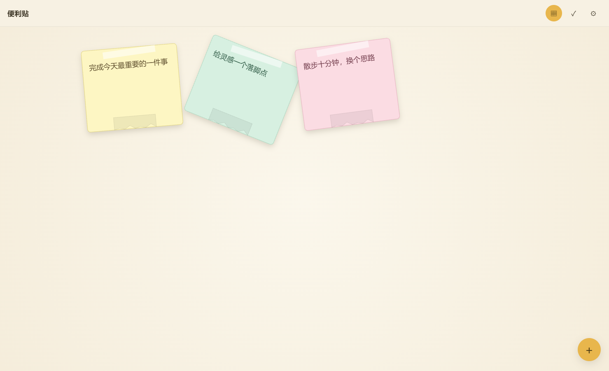
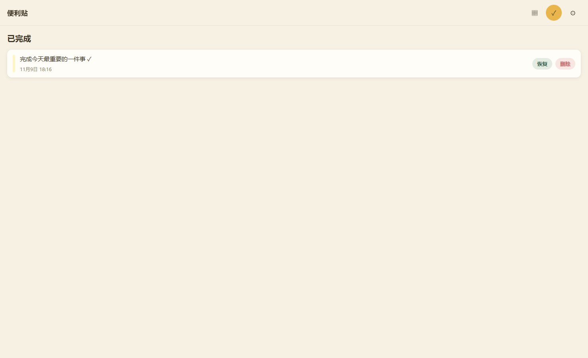

# 漂浮便利贴

基于 Vue 3、TypeScript、Canvas 2D 与 Pinia 的本地待办应用。本仓库为 Web 展示版，打开网页即可使用，不需要注册账号或部署后端服务。

[在线体验](https://m-c-kai.github.io/sticky-note-gallery/)



## 功能

- 新建、编辑便利贴，选择不同纸张颜色。
- 在画布上拖拽排列，使用漂浮动画表达轻量的桌面便签体验。
- 通过撕纸手势完成事项，并在历史记录中查看或恢复。
- 调整动画强度及外观设置。
- 在浏览器本地保存数据，刷新后继续使用。

## 运行

建议使用 Node.js 22 或更新版本。

```bash
npm ci
npm run dev
```

```bash
npm test
npm run build
npm run preview
```

`npm run build` 生成 `dist/`。可部署在支持单页应用路由回退的静态服务器上。应用采用 History 路由，直接访问子页面时需回退至 `index.html`。

## 架构

```text
Vue 页面 / 组件
      ↓
Pinia 状态与应用服务
      ↓
NoteRepository / SnapshotRepository
      ↓
浏览器 localStorage

NoteCanvas → CanvasEngine → 布局 / 手势 / 动画 / Canvas 渲染
```

业务服务负责便利贴创建、编辑、完成、恢复与排序；Canvas 引擎负责画面渲染和手势反馈；存储适配层使状态持久化与绘制逻辑相互独立。

## 目录

- `src/pages/`：首页、历史、设置。
- `src/components/`：便利贴画布、编辑器、启动与状态面板。
- `src/canvas/`：布局、手势、漂浮、撕纸、回流及渲染。
- `src/application/`：业务服务。
- `src/infrastructure/`：存储与平台适配。
- `src/domain/`：数据模型。

## 数据与使用边界

Web 版本使用当前浏览器的 localStorage，不上传便签内容，不提供云端同步。清理浏览器站点数据会移除本地记录，重要事项请自行备份。本仓库保留原工程的平台适配接口，但不包含 Android/iOS 原生工程，不能直接据此生成原生安装包。

## 验证

当前代码包含 43 项单元测试，覆盖布局、手势、漂浮/撕纸/回流动画、业务服务及仓储。发布前同时执行生产类型检查和构建；浏览器交互结果以展览馆详情中的实际验收说明为准。

2026-11-09 浏览器实测：新增三张不同颜色便签、编辑保存、刷新后数据恢复、拖拽移动、撕纸完成、历史记录查看及恢复均通过。设置页确认 Web 使用 LocalStorage，运行状态未显示错误。


